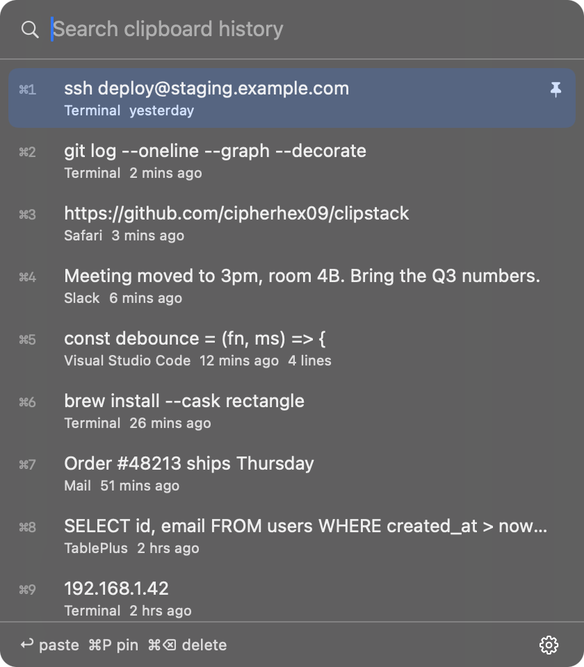
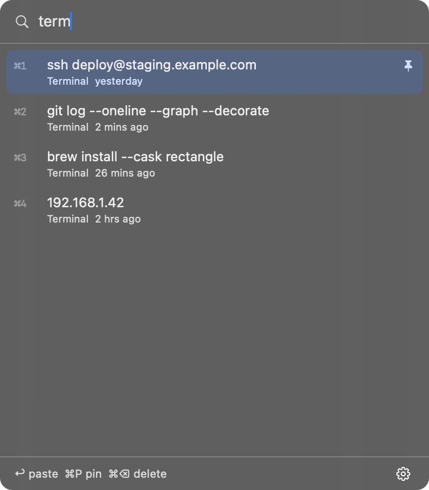

# Clipstack

A clipboard history for the macOS menu bar. Press **⌘⇧V**, type a few letters, hit Return, and the thing you copied an hour ago is pasted where you are typing.

<p align="center"></p>

- **Fast to reach.** ⌘⇧V opens the list at your cursor from any app. ⌘1 to ⌘9 paste the first nine items directly
- **Search as you type.** Every word must match. Abbreviations like `gst` for `git status` work too, and typing an app name (`terminal`, `safari`) finds what you copied there
- **Pins.** Pin snippets you paste all the time. They stay on top and are never pushed out by new items
- **Pastes for you.** Choosing an item puts it on the clipboard and presses ⌘V in the app you were using. Without Accessibility permission it just copies, and you paste
- **Leaves passwords alone.** Anything a password manager marks as secret is never recorded. Copies made while 1Password, Bitwarden, Keychain Access, Passwords, LastPass, Dashlane or Enpass are in front are skipped too
- **Stays on your Mac.** No network access at all. History is one JSON file readable only by your user account
- **Small.** Native Swift and SwiftUI, no dependencies, about 1 MB

<p align="center"></p>

## Install

Download `Clipstack.zip` from the [latest release](https://github.com/cipherhex09/clipstack/releases/latest), unzip it, and drag **Clipstack.app** into Applications.

The release is not notarized by Apple, so the first launch is blocked. Right click the app, choose **Open**, then **Open** again. Or clear the quarantine flag once:

```sh
xattr -dr com.apple.quarantine /Applications/Clipstack.app
```

### Build from source

Needs macOS 14 or newer and Xcode 15 or newer (or the matching command line tools).

```sh
git clone https://github.com/cipherhex09/clipstack
cd clipstack
./scripts/build-app.sh --install
```

That builds a universal app (Apple silicon and Intel), copies it to `/Applications`, and opens it.

## Use

| Keys | What it does |
|---|---|
| ⌘⇧V | Open or close the list (from any app) |
| type | Filter the list |
| ↑ ↓ | Move the selection |
| Return | Paste the selected item |
| ⌘1 to ⌘9 | Paste that item |
| ⌘P | Pin or unpin the selected item |
| ⌘⌫ | Delete the selected item |
| Esc | Close |

Clicking the menu bar icon opens the same list under the icon. Right click an item to pin or delete it.

The gear in the corner has the settings: pause recording, paste after choosing, launch at login, how many items to keep (50, 200, 500 or 1000; pins do not count), clear history, and quit.

### Auto-paste permission

To press ⌘V for you, Clipstack needs Accessibility access. Click **Allow auto-paste** in the panel, or add it yourself in **System Settings > Privacy & Security > Accessibility**. If you rebuild the app from source, macOS may ask again because the signature changed.

## Privacy

Clipstack only reads plain text from the clipboard. It records nothing when:

- the copied data carries a [nspasteboard.org](https://nspasteboard.org) concealed, transient or auto-generated marker, which password managers and many other apps set for secrets
- one of the password managers listed above is the frontmost app
- recording is paused from the gear menu

History is stored at `~/Library/Application Support/Clipstack/history.json` with permissions `600`. Delete that file to wipe everything, including pins.

To skip more apps, set their bundle ids (find one with `osascript -e 'id of app "Some App"'`):

```sh
defaults write io.github.cipherhex09.clipstack ignoredApps -array \
  com.1password.1password com.bitwarden.desktop com.apple.keychainaccess com.example.SomeApp
```

Then quit and reopen Clipstack. Setting this replaces the built-in list, so include the defaults you want to keep.

## How it works

macOS has no "clipboard changed" event, so Clipstack checks the pasteboard's change counter twice a second, which costs effectively nothing. The ⌘⇧V shortcut uses the Carbon hot key API, which works without Input Monitoring permission. The panel is a non-activating window, so the app you were typing in stays in front and the paste lands there.

The history, search ranking and privacy rules live in `Sources/ClipstackCore` with no AppKit, and are covered by unit tests:

```sh
swift test
```

## License

MIT
